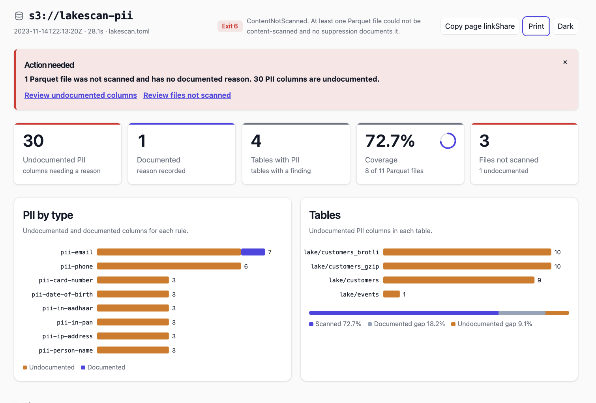
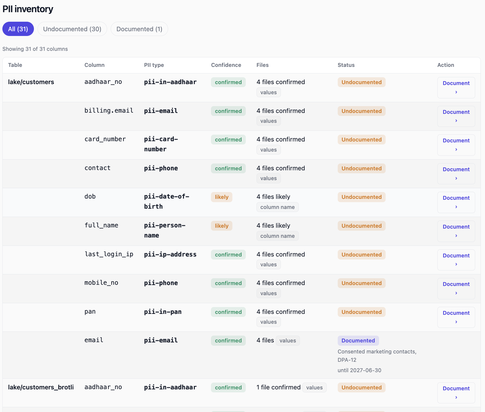

# LakeScan

LakeScan finds personal data in an S3 data lake and audits the bucket from
its object listing. It pages through `ListObjectsV2` and checks every object
against a small set of rules (secret-looking keys, deprecated or wasteful
storage classes, stale data, empty objects). With `--pii` it also looks
inside Parquet files for structured personal data: emails, phone numbers,
Indian PAN and Aadhaar numbers, card numbers, IP addresses, and, by column
name, people's names and dates of birth. It reports which columns hold what,
never the values themselves, and exits with a code your CI can act on.



A discovery aid, not a compliance assessment: no finding does not prove there is no personal data.

**Quick install (macOS Apple silicon, or Linux x86_64):**

```bash
VERSION=0.1.2
TARGET=aarch64-apple-darwin   # Linux x86_64: x86_64-unknown-linux-gnu
BASE=https://github.com/arunkumar-dot/lakescan/releases/download/v$VERSION
curl -fsSLO "$BASE/lakescan-$VERSION-$TARGET.tar.gz"
curl -fsSLO "$BASE/SHA256SUMS"
shasum -a 256 --check --ignore-missing SHA256SUMS   # Linux: sha256sum --check --ignore-missing SHA256SUMS
tar -xzf "lakescan-$VERSION-$TARGET.tar.gz"
cd "lakescan-$VERSION-$TARGET" && ./lakescan --version
```

To run it as plain `lakescan`, as the rest of this page does, copy it onto
your `PATH`:

```bash
mkdir -p ~/.local/bin && cp lakescan ~/.local/bin/
lakescan --version
```

If that prints `command not found`, `~/.local/bin` is not on your `PATH`: add
`export PATH="$HOME/.local/bin:$PATH"` to your `~/.zshrc` or `~/.bashrc` and
open a new terminal.

The other two targets (macOS Intel, Linux arm64) are in the table under
[Run the release binary](#run-the-release-binary) below.

**More:**

- [docs/TUTORIAL.md](docs/TUTORIAL.md): a worked walkthrough
- [docs/PRODUCT.md](docs/PRODUCT.md): where the product is headed, and why
- [docs/experiments/](docs/experiments/): the measurements behind the claims
- [CHANGELOG.md](CHANGELOG.md): what changed in each release
- [CONTRIBUTING.md](CONTRIBUTING.md): building and contributing

Memory is bounded by design and does not grow with the number of objects:
fixed budgets (one listing page in flight, fixed-size summaries, and a
streaming writer), checked by tests, not by a run on a very large bucket.

**Tested on.** We ran `--pii` on seven public datasets (687 MB of Parquet),
after assigning the expected answer for each column from its name and the
dataset's published description. LakeScan reported 17 columns, and 16 of
them matched the columns we had listed as personal data for these datasets
(precision 16 of 17). Of the 21 listed columns of the kinds LakeScan claims
to detect, it found 16 (recall 16 of 21). The detectors were tuned on these same seven datasets, so treat these
figures as an upper bound, not a prediction for other data. These scans ran
against a local S3 fake (moto), not real S3. The one real-S3 run used the
repository's 18 test-fixture objects (14.7 MiB, ap-south-1) and produced the
same findings as moto in every content scan. It was made from a laptop on a home connection, so it
says nothing about speed inside AWS, and speed numbers elsewhere in this
README come from a simulated S3. See [docs/experiments/](docs/experiments/).

## Getting started

1. Install the binary with the quick install above, or for
   another platform see [Run the release binary](#run-the-release-binary).

2. Make sure your AWS credentials are configured:
   ```bash
   aws configure
   # or set AWS_ACCESS_KEY_ID and AWS_SECRET_ACCESS_KEY in your shell
   ```

3. Run a metadata scan on your bucket:
   ```bash
   lakescan scan s3://your-bucket-name
   ```
   Exit 0: no findings at or above `--fail-on` (default: High).
   Exit 1: findings at or above `--fail-on` were found — read the summary.
   Exit 6: a file could not be scanned and is not documented —
   read the summary before trusting it.

4. Add `--pii` to also scan Parquet files for personal data:
   ```bash
   lakescan scan s3://your-bucket-name --pii --html report.html
   open report.html   # macOS; xdg-open on Linux
   ```
   This opens an interactive offline dashboard in your browser
   showing which tables and columns hold personal data.

5. When a finding is expected (a column that is meant to hold
   personal data), document it with a suppression entry in a
   TOML config file:
   ```toml
   [[suppress]]
   rule    = "pii-email"
   prefix  = "lake/customers/"
   column  = "email"
   reason  = "Consented billing contacts, covered by our DPA"
   expires = 2027-06-30
   ```
   Then rerun with `--config your-config.toml`. The finding moves
   from undocumented to documented in the inventory.

Full flag reference: see [Usage](#usage) below.

## Run the release binary

Download the archive for your platform from the
[Releases](https://github.com/arunkumar-dot/lakescan/releases) page, along
with `SHA256SUMS`:

| Platform | Archive |
|---|---|
| macOS, Apple silicon | `lakescan-<version>-aarch64-apple-darwin.tar.gz` |
| macOS, Intel | `lakescan-<version>-x86_64-apple-darwin.tar.gz` |
| Linux, x86_64 | `lakescan-<version>-x86_64-unknown-linux-gnu.tar.gz` |
| Linux, arm64 (Graviton) | `lakescan-<version>-aarch64-unknown-linux-gnu.tar.gz` |

The Linux binaries need glibc 2.17 or newer: Amazon Linux 2023, Ubuntu 22.04
and later, and most distributions since 2014. Each archive holds the
`lakescan` binary, `LICENSE` and `README.md`.

**Windows:** A native Windows binary is not yet available.
The Linux x86_64 binary runs under WSL2 (Windows Subsystem for
Linux), which is the recommended path. Inside a WSL2 terminal,
use the Linux x86_64 install commands above. Alternatively,
install from source with `cargo install` as shown below.

Verify the download against `SHA256SUMS`, then unpack it:

```sh
VERSION=0.1.2
TARGET=x86_64-unknown-linux-gnu   # or one of the others above
sha256sum --check --ignore-missing SHA256SUMS   # macOS: shasum -a 256 --check --ignore-missing SHA256SUMS
tar -xzf "lakescan-$VERSION-$TARGET.tar.gz"
cd "lakescan-$VERSION-$TARGET"
./lakescan --version
```

Each archive also carries a signed build provenance attestation, linking
it to the workflow run and commit that built it. Verify it with the [GitHub CLI](https://cli.github.com/):

```sh
gh attestation verify "lakescan-$VERSION-$TARGET.tar.gz" --repo arunkumar-dot/lakescan
```

**macOS: the binary is not signed.** macOS quarantines files downloaded by a
browser and refuses to run an unsigned binary from one. After the checksum
above has matched, remove the quarantine attribute from that exact file:

```sh
xattr -d com.apple.quarantine "lakescan-$VERSION-$TARGET/lakescan"
```

A download with `curl` or `gh release download` is not quarantined: there
`xattr` answers `No such xattr: com.apple.quarantine`, which means there is
nothing to remove.

Installing from source, with Rust 1.94.1 or newer, is the other way to get
the same binary:

```sh
cargo install --locked --git https://github.com/arunkumar-dot/lakescan.git --tag v0.1.2
lakescan --version
```

Or clone the repository and run `cargo build --release`; the binary is
`target/release/lakescan`.

## Try the local demo from source

> Docker is only needed for this local demo. Scanning a real
> S3 bucket requires only the binary and AWS credentials —
> see [Run the release binary](#run-the-release-binary).

The repository includes a seeder that fills a local S3 fake with a demo
bucket. That bucket has 2,413 objects across three listing pages, a few
planted problems, and some hostile key names. This stays on your machine:
Docker, Rust 1.94.1 or newer (`rustc --version`), and no AWS account. moto
accepts any credentials, so the ones below are dummies. Exit code 1 means
the scan finished and found findings at or above `--fail-on` (here, High).

`--endpoint-url` is only for an S3-compatible service such as this local
moto. Do not put that URL in the environment: an exported `AWS_ENDPOINT_URL`
would send a later scan of a real bucket to the wrong endpoint.

```sh
rustc --version   # 1.94.1 or newer

# On macOS, AirPlay Receiver already listens on port 5000, so map 5001.
docker run --rm -d --name lakescan-moto -p 5001:5000 motoserver/moto:5.2.3

AWS_ACCESS_KEY_ID=test AWS_SECRET_ACCESS_KEY=test AWS_REGION=us-east-1 \
  cargo run --example seed_local -- http://localhost:5001

AWS_ACCESS_KEY_ID=test AWS_SECRET_ACCESS_KEY=test AWS_REGION=us-east-1 \
  cargo run --release -- scan s3://lakescan-demo --endpoint-url http://localhost:5001
echo "exit code: $?"    # 1: findings

AWS_ACCESS_KEY_ID=test AWS_SECRET_ACCESS_KEY=test AWS_REGION=us-east-1 \
  cargo run --release -- scan s3://lakescan-demo --endpoint-url http://localhost:5001 \
  --html report.html --quiet > /dev/null
open report.html        # macOS; xdg-open on Linux, start on Windows

docker stop lakescan-moto
```

`scripts/demo.sh` walks the same buckets and explains each section. It
honours `MOTO_PORT` (default 5001): `MOTO_PORT=5002 scripts/demo.sh --no-pause`.

**Troubleshooting.** If `docker run` fails immediately, Docker is not
running: start Docker Desktop, or the daemon, and try again. If it fails
because the port is taken, something else is bound there (on macOS that is
often AirPlay Receiver on 5000). Pick a free host port, pass it as
`MOTO_PORT`, and use that same port in `--endpoint-url`. If the scan then
says it cannot connect, moto is not listening on the URL you passed: `curl`
the endpoint, and check `docker ps` for `lakescan-moto`.

## Permissions

Before listing anything, LakeScan checks that your credentials work
(`sts:GetCallerIdentity`) and that the bucket is reachable (`s3:HeadBucket`,
authorised by `s3:ListBucket`). A failure there exits with code 3 (access) or
2 (missing bucket or wrong region) and a message saying what to fix. The
permissions, in full:

| Action | Resource | Needed |
|---|---|---|
| `s3:ListBucket` | `arn:aws:s3:::<bucket>` | always |
| `s3:GetObject` | `arn:aws:s3:::<bucket>/*` | with `--pii` |
| `kms:Decrypt` | the KMS key ARN | with `--pii`, when the objects use SSE-KMS |
| `sts:GetCallerIdentity` | `*` | always (the credential check) |

This policy lists one prefix and reads objects under it:

```json
{
  "Version": "2012-10-17",
  "Statement": [
    {
      "Sid": "CheckCredentials",
      "Effect": "Allow",
      "Action": "sts:GetCallerIdentity",
      "Resource": "*"
    },
    {
      "Sid": "ListThePrefix",
      "Effect": "Allow",
      "Action": "s3:ListBucket",
      "Resource": "arn:aws:s3:::example-bucket",
      "Condition": {
        "StringLike": { "s3:prefix": ["lake/customers", "lake/customers/*"] }
      }
    },
    {
      "Sid": "ReadObjectsForPii",
      "Effect": "Allow",
      "Action": "s3:GetObject",
      "Resource": "arn:aws:s3:::example-bucket/lake/customers/*"
    },
    {
      "Sid": "DecryptSseKms",
      "Effect": "Allow",
      "Action": "kms:Decrypt",
      "Resource": "arn:aws:kms:us-east-1:111122223333:key/00000000-0000-0000-0000-000000000000"
    }
  ]
}
```

Drop the `GetObject` and `Decrypt` statements for a listing-only scan. A
refused read is `content-not-scanned` with reason `access-denied`, and fails
the run with exit code 6 unless you document it.

## Usage

```text
lakescan scan <TARGET> [OPTIONS]
lakescan rules
lakescan --help | --version
```

`lakescan rules` prints every rule's code and title, one per line.

`lakescan scan` lists `<TARGET>`, which must be `s3://bucket` or
`s3://bucket/prefix`. An empty prefix (`s3://bucket/`) scans the whole bucket.
AWS credentials and the region come from the standard AWS configuration chain:
environment variables, shared config and credentials files, then
container or instance credentials.

| Flag | Default | Meaning |
|---|---|---|
| `--format text\|json` | `text` | Summary format. |
| `--output <PATH>` | stdout | Write the summary to `PATH`. `-` means stdout. |
| `--findings <PATH>` | off | Also stream every unsuppressed finding to `PATH` as JSON Lines, one record per finding, as it is found. `-` means stdout, which then requires `--output` to name a file. |
| `--fail-on <LEVEL>` | `high` | Exit 1 when the worst unsuppressed finding is at or above `LEVEL`: `info`, `low`, `medium`, `high`, `critical`, or `none` (never fail on findings). |
| `--region <REGION>` | from config | Overrides the configured AWS region. |
| `--endpoint-url <URL>` | AWS | An S3-compatible endpoint (`http://` or `https://`). Implies path-style addressing. |
| `--config <PATH>` | none | A suppression file (see [Suppressions](#suppressions)). Only used when given; never discovered automatically. |
| `--quiet` | off | No progress line, no result block and no suppression warnings on stderr. |
| `--full` | off | Show every section of the text summary on a terminal. There, when the summary goes to stdout, it is compact by default: the SAMPLES, LARGEST OBJECTS, SIZE HISTOGRAM, AGE HISTOGRAM and DISTINCT CONTENT sections are left out and the last line says so. Findings, coverage, the PII inventory and the files not scanned are never left out. Redirected or piped stdout, and `--output`, always get the full summary, so `--full` changes nothing there. |
| `--color auto\|always\|never` | `auto` | When to colour `lakescan`'s own output: the text summary on stdout and the result block on stderr. `auto` colours a terminal, unless `NO_COLOR` is set (to a non-empty value) or `TERM` is `dumb`. `always` overrides `NO_COLOR`. Colour is sparse: headings and `UNDOCUMENTED` are bold, `documented` is green, and red appears once in the summary (the worst severity in VERDICT, when it is high or critical) and once in the result block (the exit 6 verdict). Colour is never written into a file (`--output`, `--findings`, `--inventory`, `--html`) and never applied to anything derived from a bucket (keys, table and column names, reasons). `--help` is coloured by its own rules (a terminal, no `NO_COLOR`) and ignores this flag. |
| `--pii` | off | Also scan Parquet for structured personal data, including extensionless Parquet found by sniffing. Sampled inspection, list and map columns included; free text and other formats are skipped. See [PII content scanning](#pii-content-scanning). Without it, no object is read. |
| `--pii-sniff unknown\|none` | `unknown` | With `--pii`: which objects without a `.parquet` or `.parq` extension to sniff. `unknown` (default) sniffs a key with no extension, or an extension not on the known non-Parquet list, with one ranged GET of the last 8 bytes, and checks the `PAR1` magic. `none` sniffs nothing. Folder markers and zero-byte objects are never candidates. Each sniff is one small GET, counted in the GET totals. Requires `--pii`. |
| `--pii-whole-file-max <BYTES>` | `8388608` (8 MiB) | With `--pii`: Parquet files of at most `BYTES` are downloaded whole, in one request, and still sampled. Larger ones are read partially. `0` to `67108864` (64 MiB). Requires `--pii`. |
| `--concurrency <N>` | `16` | With `--pii`: Parquet files scanned at once, `1` to `256`. Findings, the inventory and the summary are the same for any value, apart from this number in the recorded settings and the timing lines. Requires `--pii`. See [Speed and memory](#speed-and-memory). |
| `--memory-budget <BYTES>` | `536870912` (512 MiB) | With `--pii`: the most bytes in-flight file scans hold at once. Must cover the most one file can need (~108 MiB at the default `--pii-whole-file-max`, ~137 MiB at 64 MiB), and at most `68719476736` (64 GiB). Anything else is a usage error; the semaphore is created with exactly this many permits. Requires `--pii`. |
| `--coalesce-gap <BYTES>` | `1048576` (1 MiB) | With `--pii`: page ranges of one file at most `BYTES` apart are read as one request (merged reads stay within 8 MiB). `0` reads each range alone. Requires `--pii`. |
| `--html <PATH>` | off | Also write an interactive [HTML dashboard](#html-report) to `PATH`. `-` means stdout, which then requires every other output to go to a file. Works with or without `--pii`. Open the file in any browser; it works offline and makes no network requests. |
| `--inventory <PATH>` | off | With `--pii`: also write the [PII inventory](#pii-inventory-and-coverage) as CSV to `PATH`, one row per table, column and rule. `-` means stdout, which then requires `--output` to name a file, and `--findings` not to be `-`. Requires `--pii`. |

When stderr is a terminal (and `--quiet` is not given), `lakescan scan` shows
one line that updates in place while it runs, for example
`| listed 2413 objects, 11 files checked, 7s`: a spinner, the objects
listed so far, the files whose check has finished (with `--pii`) or the
findings so far (without it), and the elapsed time. "Checked" means the
check ended, whatever its outcome: a file that could not be scanned, or an
object that was sniffed and is not Parquet, counts too. The summary and the
result block say "scanned" only for files that were actually scanned. There is no percentage and
no ETA, because the listing streams and the total is not known. With `--pii` it
shows no findings count: content findings are only known once files are
applied in listing order, and a count that lagged the real one would mislead.
The line is erased when the scan ends. On a terminal that cannot redraw a line
(`TERM=dumb`) there is no live line. When the run completes, a short result
block follows the summary on stderr: the exit code and what it means, the
number of undocumented PII columns, how many Parquet files were scanned (and
that inspection is sampled), and next steps. It is only ever printed to a
terminal; when stderr is redirected or piped nothing of this is written, so
scripts see exactly the lines described below. For the same reason, the
`--pii` permissions hint (`lakescan: --pii requires s3:GetObject …`) is only
printed when stderr is not a terminal; the exit 6 explanation names the
permissions whenever any undocumented file was refused (off a terminal, only
when most were). Errors print one line to
stderr, `lakescan: <error>`.
A listing that returns no objects still exits 0, but prints `lakescan: no
objects found under s3://<bucket>/<prefix>; check that the prefix is correct`
to stderr, `--quiet` or not, so a mistyped prefix does not pass silently. When
the bucket is in a different region, the error names that region, from S3's
redirect response.

### Output files

Every file output (`--output`, `--findings`, `--inventory`, `--html`) is
written to a temporary file in the same directory and renamed into place
only when the run finishes. A failed run removes the temporary file and
leaves any previous file untouched. Stdout is written directly, with no
temporary file. `-` means stdout.

| Flag | Writes | Stdout |
|---|---|---|
| `--output <PATH>` | The text or JSON summary. Omitted, or `-`, writes it to stdout. | The default destination for the summary. |
| `--findings <PATH>` | Every unsuppressed finding as JSON Lines, as it is found. | `-` requires `--output` to name a file, so the summary is not mixed into the stream. |
| `--inventory <PATH>` | The PII inventory as CSV. Requires `--pii`. | `-` requires `--output` to name a file, and `--findings` not to be `-`. |
| `--html <PATH>` | An interactive HTML dashboard. Works with or without `--pii`. | `-` requires every other output to go to a file. |

One of them may be stdout. Two may not: `--findings -` with the summary
also on stdout is a usage error, and so is `--html -` together with any
other stdout output. These are valid:

```sh
lakescan scan s3://example-bucket --format json > summary.json
lakescan scan s3://example-bucket --output summary.txt --findings findings.jsonl
lakescan scan s3://example-bucket --pii --output summary.txt --inventory inventory.csv --html report.html
lakescan scan s3://example-bucket --pii --format json --output summary.json --findings -
```

The last one puts the findings stream on stdout and the summary in a file.
If the inventory is truncated, the text and HTML say so, and
`pii_inventory.truncated` in that JSON is `true`. A CSV consumer should
check that flag: the CSV itself has no room for it.

## Exit codes

The numbers are a stable contract. CI can branch on them.

| Code | Name | Meaning |
|---|---|---|
| 0 | `Ok` | The scan completed and no unsuppressed finding reached `--fail-on`. |
| 1 | `FindingsExceedThreshold` | The scan completed, but an unsuppressed finding reached `--fail-on`. |
| 2 | `Usage` | Bad arguments, an invalid target or config file, a nonexistent bucket, or a region mismatch. |
| 3 | `Auth` | Credentials are missing, expired, or rejected. |
| 4 | `Transport` | The network or S3 failed (DNS, TLS, timeouts, 5xx, an unparseable response). Often worth retrying. |
| 5 | `Report` | The summary or findings stream could not be written (full disk, bad path, permissions). |
| 6 | `ContentNotScanned` | `--pii` was given and at least one Parquet file could not be content-scanned (unreadable, encrypted, refused, a read that kept failing, not Parquet, a wait for memory-budget permits longer than 10 minutes, or with every readable column skipped) without a `content-not-scanned` suppression documenting it. Coverage fails closed: one such file among thousands of readable ones is enough. The summary is still written, and stderr gives the counts by reason. Takes precedence over 1. |

Exit code 6 is decided before 1. A run with both confirmed PII and an
undocumented unscanned file exits 6, not 1. CI can branch on the three
codes a finished scan uses:

```sh
lakescan scan s3://example-bucket --pii --format json --output summary.json
code=$?
case "$code" in
  0) echo "scan finished; nothing at or above --fail-on" ;;
  1) echo "findings at or above --fail-on; coverage is accounted for" ;;
  6) echo "coverage is incomplete; read the summary before trusting it" ;;
  *) echo "lakescan failed ($code)"; exit "$code" ;;
esac
```

A closed pipe (`lakescan ... | head`) is not an error.

Exit status 101 is outside this contract. It means an internal error: a bug
in LakeScan itself, which panicked. stderr then names the source location
(never the message, which could quote scanned data). Please report it, with
that line and the command you ran. A panic inside the Parquet parser while
reading one file is not this: it is contained, and that file becomes
`content-not-scanned`.

## Rules

Rules see only what a listing reports for each object: key, size,
last-modified time, ETag, and storage class.

| Code | Severities | Flags | Why |
|---|---|---|---|
| `sensitive-key` | high, medium | High: a key whose name is a secret file on its own (`.env`, `.env.*` except `.env.example`, `.env.sample` and `.env.template`, `.netrc`, `.npmrc`, `.pypirc`, `.git-credentials`, `.htpasswd`, `id_rsa`, `id_dsa`, `id_ecdsa`, `id_ed25519`), ends in `.tfstate`, `.tfstate.backup`, `.ppk`, `.kdbx`, or is `.aws/credentials` (a file named `credentials` directly inside a `.aws` directory, at any depth). Medium: a name ending in `.pem`, `.key`, `.p12`, `.pfx`, `.jks`, `.keystore`, or any key with a `.git` or `.ssh` path segment (anything under a `.git/` or `.ssh/` directory). Matching is case-insensitive. | Credentials in a data lake get copied, shared and exposed far more easily than credentials in a secrets manager. |
| `reduced-redundancy` | medium | Objects in `REDUCED_REDUNDANCY`. | The class is deprecated: it gives up durability and is no longer cheaper than `STANDARD`. |
| `stale-standard` | low, medium | `STANDARD` objects unmodified for more than 90 days. Low at 128 KiB or more, medium at 1 GiB or more. Smaller objects are never flagged. | They are candidates for a cheaper class or a lifecycle rule. Below 128 KiB, IA classes bill a minimum size and Intelligent-Tiering won't tier the object, so moving it would cost more. |
| `small-object-cold-tier` | low | Objects under 128 KiB in `STANDARD_IA`, `ONEZONE_IA`, `GLACIER_IR`, `GLACIER` or `DEEP_ARCHIVE`. | These classes bill a minimum object size (and Glacier adds per-object overhead), so small objects cost more there than in `STANDARD`. |
| `zero-byte-object` | info | Empty objects whose key does not end in `/`. | These are usually failed uploads or leftover scaffolding. Empty `folder/` markers are what consoles create, and they are not flagged. |
| `unknown-storage-class` | info | A storage class this build of LakeScan does not recognize. | This is a newer class than this build knows about. The other rules cannot judge such an object, so LakeScan says so instead of guessing. |

No v1 rule raises `critical`: a listing alone cannot prove an object is
exposed.

With `--pii`, these content rules also apply to Parquet files. Each finding
names one column, and its severity follows from its confidence (see
[Confidence and severity](#confidence-and-severity)):

| Code | Flags |
|---|---|
| `pii-email` | A column of email addresses. |
| `pii-phone` | A column of phone numbers: E.164 (`+14155550123`), Indian mobile numbers with an optional `+91`, `91` or `0`, and, written with separators as people write them, North American numbers (`(201) 555-0123`, `+1 201 555 0123`), national numbers with a trunk `0` (UK and EU: `020 7946 0123`, `01 23 45 67 89`) and international numbers dialled with `00`. Spaces, dashes, dots, slashes and parentheses are separators. A bare run of digits (no `+`, no separators, as in any integer column) counts only as an Indian mobile number, and only in a column whose name has a phone or contact word in it (`phone`, `mobile`, `cell`, `tel`, `contact`, `msisdn`): elsewhere it is as likely an identifier (a US NPI number looks like an Indian mobile). A phone column is `confirmed` only when its name is about a person or a personal device (`customer_phone`, `contact`, `mobile`) or at least 95% of its values match: organisations have phone numbers too. |
| `pii-in-pan` | A column of Indian PAN numbers (`ABCPE1234F`, in either case). |
| `pii-in-aadhaar` | A column of Aadhaar numbers: 12 digits, the first 2–9, with a valid Verhoeff check digit. |
| `pii-card-number` | A column of payment card numbers: 13 to 19 digits with a valid Luhn check digit. |
| `pii-ip-address` | A column of IPv4 or IPv6 addresses. |
| `pii-person-name` | A column whose name says it holds people's names: a name part as the whole name (`FIRST`, `LAST`, `MAIDEN`, `family`, `given`), a name word (`surname`, `forename`, `fname`, `lname`), or `name` qualified by a name part or a person noun (`full_name`, `nameFirst`, `customer_display_name`, `username`). A bare `name`, or one qualified by anything else (`Short Name`, `drug_name`, `company_name`), is no hint. Detected by name only. |
| `pii-date-of-birth` | A column whose name says it holds dates of birth (`dob`, `birth_date`, `date_of_birth`, `birthdate`, `bdate`, `bday`, …), but not a count, rate or flag of births (`multipleBirthInteger`, `birth_rate`, `births`). Detected by name only. |
| `content-not-scanned` | `info`: a Parquet file that could not be scanned, with a reason: `not-parquet`, `unreadable`, `access-denied`, `encrypted`, `footer-too-large`, `no-column-examined` (it has string or integer columns, but every one was skipped, so no value was examined), `fetch-failed` (a `GetObject` still failed after the SDK's retries: throttling, timeouts, 5xx, an object deleted mid-scan), `too-many-columns` (the schema has more than 16,384 leaf columns), or `budget-timeout` (it waited more than 10 minutes for memory-budget permits). It never stops the scan, but unless suppressed it fails the run with exit code 6 (see [Coverage](#coverage-fails-closed)). |

## PII content scanning

`--pii` reads Parquet, and only Parquet. A key ending in `.parquet` or
`.parq` (any case) is eligible. With `--pii-sniff unknown` (the default),
so is an object whose key has no extension, or an extension that is not on
the known non-Parquet list (`.json`, `.jsonl`, `.csv`, `.tsv`, `.txt`,
`.log`, `.gz`, `.zip`, `.avro`, `.orc`, `.xml`, `.html`, `.png`, `.jpg`,
`.jpeg`, `.gif`, `.pdf`, and the rest of that list). Athena CTAS and
Trino/Hive writers often omit the extension; without sniffing, a lake of
those files would exit 0 with nothing scanned. Each candidate gets one
ranged GET of its last 8 bytes. `PAR1` there means Parquet, and the file
then follows the normal read plan. Anything else is counted as sniffed, not
Parquet, and is out of scope, not a failure. Folder markers and zero-byte
objects are never sniffed. `--pii-sniff none` turns this off. The cost is
one small GET per candidate, included in `GET requests` and in `sniffed`.

Inspection is sampled in every mode. LakeScan reads the dictionary page, if
the writer stored one, and the first data page of a column, in up to 3 row
groups and at most 2,000 values per column per row group. A file at or
below `--pii-whole-file-max` is downloaded whole, in one request, and then
sampled the same way. A whole-file download is not an exhaustive read of
every page. Repeated (list and map) columns are read like any other. Free text is not
scanned: an email inside a notes column is not a finding. CSV, JSON, Avro,
ORC and every other format are not read.

Up to `--concurrency` files are scanned at once (see [Speed and
memory](#speed-and-memory)).

**What is read.** A file of at most `--pii-whole-file-max` bytes (8 MiB by
default) is downloaded whole, in one request. For a larger file, LakeScan reads:

- the footer, with one 64 KiB tail read (plus a second read if the footer is
  longer than that), and the offset indexes, if the writer wrote them: free
  when they are in the tail, else one read for all of them;
- for each candidate column, its dictionary page, if any, and the first data
  page of row group 0. With an offset index, that is one exact range.
  Without one, the range is found by reading page headers. A row group's
  ranges are coalesced (see [Speed and memory](#speed-and-memory)).

A column whose sample is too small or too ambiguous after row group 0 is
sampled again in the middle row group, then the last: never more than 3 row
groups per column. This catches junk or nulls clustered at the start of a
file. Candidate columns are string, binary, INT32 and INT64 columns, plus
DATE and TIMESTAMP columns for the date-of-birth name check. Struct fields
count, and so do the leaves of lists and maps (`tags.list.element`,
`telecom.list.element.value`), named for their hints by the field behind
the list or map wrapper (`value`, `given`). A repeated column's first data
page may declare at most 131,072 values; a larger one is `page-too-large`.
At most 2,000 values per column per row group are evaluated.

A candidate column is skipped, and counted by reason, when its first pages
are over the page cap (`page-too-large`), can't be decoded (`unreadable`),
or use a codec LakeScan doesn't decode (`unsupported-codec`: LZO). Every
other codec is read: uncompressed, Snappy, GZIP, LZ4, LZ4_RAW, ZSTD and
BROTLI. A file whose string and integer columns were *all* skipped is not
counted as scanned: it is `content-not-scanned` with reason
`no-column-examined`, so a lake LakeScan couldn't actually read can't pass
silently. Findings that rest on a column's name alone, such as a date of
birth, are still reported for such a file. A file with no string or integer
columns at all (only doubles, say) has nothing to examine and counts as
scanned.

### Columns not examined

A column that could hold personal data but wasn't examined is recorded, so
a table whose personal-data columns couldn't be checked never reads as
clean. That is a string or integer column skipped for any reason
(`page-too-large`, `unreadable`, `unsupported-codec`), and a column of a type
LakeScan doesn't read (a float, a decimal, a time; not a boolean) whose name
hints personal data, such as a phone number stored as a double
(`unsupported-type`). Each table counts them per reason, once per file; a
table with no PII found and any such column has status
`columns_not_examined`, `No structured PII detected in the columns examined
from N files; PII unknown in the columns not examined`, and lists the
columns. COVERAGE gives the totals. The 64 smallest `(table, column,
reason)` are listed, in every format (in CSV as `NOT_EXAMINED` rows, with
the reason in the last column, `not_examined_reason`); the counts include
every one. Columns not examined are reported, not failed on: they don't
change the exit code.

Each file's `PAR1` magic bytes are checked first. A file without them is not
Parquet and is skipped (`content-not-scanned`, `not-parquet`), not an error.

**Cleaning.** Before anything is counted, values are trimmed. Nulls, empty
strings, values made of one repeated character (`0000000000`, `----`) and
the placeholders `n/a`, `na`, `null`, `none`, `nil`, `unknown`, `undefined`,
`unk`, `tbd`, `test`, `sample`, `dummy`, `-`, `?` and `.` (in any case) are
dropped. So are three sentinels seen in real datasets: emails at the
reserved test domains `example.com`, `example.org` and `example.net` (and
their subdomains) or under `.test`, which are test accounts, not people;
masked values, with a run of four or more of one masking symbol (`*`, `x`,
`X`, `#`, `•`, `-`: `****1234`, `XXXX-XXXX-XXXX-0004`); and the dates
`1900-01-01` and `1970-01-01` (with an all-zero time, if any). So is a
value that makes up more than half of a column's sample, such as a default
address, unless it is the column's only value. A column with no value left
after cleaning (all null, empty or placeholder) is never reported, whatever
its name; a date column whose statistics say it is all null neither.

### Confidence and severity

| Confidence | When | Severity |
|---|---|---|
| `confirmed` | At least 80% of at least 30 cleaned values match (for a phone column whose name isn't about a person, at least 95%). | `high` |
| `likely` | 50–80% of at least 30 cleaned values match; or at least 80% match but there are fewer than 30; or the column's name suggests the type and at least one value matches; or, for names and dates of birth, a clear name hint on a column of fitting type. | `medium` |
| `possible` | The column's name suggests the type, but there is no value evidence. | `info` |

Each finding says what it rests on: `evidence=values matched=X/Y` (in
JSON, `"evidence": "values"` with `matched` and `sampled`) when sampled values
validated, or `evidence=column-name` (`"evidence": "column-name"`, no counts)
when only the column's name and type support it. Names and dates of birth are
always `column-name`.

Values override names. A column with at least 30 cleaned values, none of
which match, is never reported for that type, whatever it is called. So a
column of hashes named `email_sha256` is not an email finding. A `pan` column
name is only an Indian PAN finding if a value matches, so a card's "primary
account number" column isn't mistaken for a tax ID. When values match more
than one type, the most confident wins, then the stricter validator
(checksums before patterns). Each column gets at most one finding.

With the default `--fail-on high`, a confirmed PII column fails the run
(exit code 1).

### Hostile files

Anyone who can upload to a scanned bucket chooses the bytes of every Parquet
file in it, so LakeScan treats every file as hostile. One crafted file must
never crash the scan or exhaust memory:

- **Every page header is checked before any allocation for the page.** That
  covers dictionary and data pages, on both the whole-file and partial
  paths. A page declaring more than 8 MiB compressed or uncompressed, or a
  dictionary declaring more than 1,048,576 values, skips its column as
  `page-too-large`. Nothing is allocated for it.
- **Decompression stops at the declared size.** Snappy, ZSTD, LZ4 and
  LZ4_RAW pages are decompressed by the Parquet parser into a buffer of the
  declared size (LZ4's unbounded frame fallback is off). The parser's GZIP
  and BROTLI decoders would write as much as the stream produces, so
  LakeScan decompresses those pages itself. It reads at most the declared
  size plus one byte, and a page whose output doesn't exactly match its
  declared size is `unreadable`, however much more the stream holds. Brotli
  streams asking for a window over 16 MiB ("large window" Brotli) are
  refused before decoding, because the decoder would allocate the whole
  window up front.
- **LakeScan's own page-header reader is fuzzed.** A test feeds it 100,000
  random and mutated headers and checks it always returns a result or an
  error, without panicking.
- **A parser panic costs one file.** The Parquet parser is third-party code,
  so a panic inside it becomes `content-not-scanned` (reason `unreadable`)
  for that file, and the scan continues. Its message is never printed,
  because it could quote file contents.

### No values in the output

LakeScan never writes a sampled value anywhere: not in the text or JSON
summary, the `--findings` stream, warnings, or error messages. A finding
carries the file, the column path (at most 256 bytes), the confidence, and
two counts, `matched` and `sampled`. A test seeds known values into Parquet
files and checks that none appears in any output.

### Permissions and cost

Content scanning needs `s3:GetObject` on the objects it reads. For objects
encrypted with SSE-KMS it also needs `kms:Decrypt` on their key. A refused
read is a `content-not-scanned` finding with reason `access-denied`, and
fails the run with exit code 6 unless documented (see
[Coverage](#coverage-fails-closed)). If most undocumented files were
refused, stderr also names the missing permissions.

The cost is S3 `GET` requests: one for a small file, and for a large one
one for the footer, one for the offset indexes if they aren't in it, and
one or two per sampled column and row group, fewer when coalescing merges
them (see below). Add data transfer for the bytes read when you run
outside the bucket's AWS region. The `CONTENT` section (`content` in JSON)
reports `bytes_read` and `get_requests`, so you can see what a scan cost.

### Speed and memory

Content scanning runs up to `--concurrency` files at once (16 by
default). Results are applied in listing order, so the summary, the
findings stream and the inventory are the same for any `--concurrency`,
apart from the recorded `concurrency` and the timing lines.
Decoding runs on a separate thread pool, so it doesn't stall reads.
`GetObject` uses the SDK's adaptive retry mode, which slows down when S3
throttles (503 `SlowDown`); a read that still fails becomes
`content-not-scanned` with reason `fetch-failed`, which fails the run (exit
code 6) unless documented.

**Memory is bounded by `--memory-budget`** (512 MiB by default). Every read
and every decode takes permits for its bytes (the bytes fetched, or the
page sizes a header declares) before it starts, and gives them back when
its buffers are freed. One file never needs more than ~108 MiB under
LakeScan's caps (~137 MiB with `--pii-whole-file-max 64MiB`), and a budget
below that is a usage error, since that file could never start. Files
share the budget so that none can wait forever: each in-flight file may
hold an equal share freely, and one file at a time may go beyond it. On
top of the budget, each in-flight file holds a few kilobytes of state and
up to ~0.8 MiB of page locations. A bigger budget lets more files proceed at
once without waiting for memory at high `--concurrency`: with 512 MiB, a whole-file read fits
in each file's share at the default concurrency of 16. A file that goes
past its share takes the one overflow lane and gives it back as soon as
what it holds drops to its share, so the next file can use it. A wait
longer than 10 minutes makes that file `content-not-scanned` with reason
`budget-timeout`.

**Coalescing trades bytes for requests.** Within a partially read file,
each round's page reads (the first pages of every column in row group 0,
then of the columns that need more) are sorted and merged when they are at
most `--coalesce-gap` apart (1 MiB by default; merged reads stay within 8
MiB), and up to 4 are fetched at once. The bytes between merged ranges are
read too. That is meant to help files with small row groups, and should do little
for files with a few large ones (measured only on a simulated S3). S3 bills per request, and egress per byte
outside its region: where egress costs more than requests and time, set
`--coalesce-gap 0`. Simulated measurements, and their limits, are in
[docs/experiments/scan-speed.md](docs/experiments/scan-speed.md).

### PII inventory and coverage

With `--pii`, the summary ends its content sections with COVERAGE and PII
INVENTORY: where personal data lives, by table and column, and whether each
location is documented. It is an inventory a privacy
team can use as one input to its own review. It is not an audit report or a
compliance certificate.

```text
COVERAGE
  parquet files:  11
  scanned:        8 (72.7%)
  not scanned:    1 documented, 2 undocumented
  inspection:     sampled: the dictionary and first data page of each column in up to 3 row groups, at most 2,000 values per column per row group; files read whole are downloaded whole but sampled the same way
  columns not examined: 0 in 0 files of 0 tables
  Not in scope for --pii: none by extension
  sniffed, not Parquet: 0
  empty objects and folder markers: 0

PII INVENTORY
  4 tables with PII, 31 PII columns: 30 undocumented (24 confirmed, 6 likely, 0 possible), 1 documented. Action needed on the undocumented. 2 tables with files not scanned (0 documented), 0 with columns not examined.
  Tables are inferred from object paths. Documented means your team recorded a reason: an operational exception, not a compliance approval.
  bad  files: 0 scanned, 2 not scanned (not-parquet=1 documented, unreadable=1 undocumented); files dated 2026-10-20 to 2026-10-20
    not scanned: PII unknown
  lake/customers  files: 4 scanned, 0 not scanned; files dated 2026-10-20 to 2026-10-20
    example: lake/customers/dt=2026-01-01/part-0.parquet
    aadhaar_no  pii-in-aadhaar  confirmed  evidence=values  4 files confirmed  UNDOCUMENTED
    full_name  pii-person-name  likely  evidence=column-name  4 files likely  UNDOCUMENTED
    pan  pii-in-pan  confirmed  evidence=values  4 files confirmed  UNDOCUMENTED
    email  pii-email  confirmed  evidence=values  4 files, documented until 2027-06-30: Consented marketing contacts, DPA-12
```



(Trimmed: the real output lists every table and row.)

The headline counts the action items: undocumented PII locations, tables
with files that weren't scanned, and tables with [columns not
examined](#columns-not-examined). A table never claims more than was read:
one with no file scanned says `not scanned: PII unknown`, one where columns
that could hold PII weren't examined says so and lists them, and one where
nothing was found says `No structured PII detected in sampled data from N files`, adding
`; M not scanned` when some weren't (JSON: each table's `status`,
`pii_found`, `no_pii_in_scanned_files`, `columns_not_examined` or
`not_scanned`, and
`pii_inventory.summary` for the headline). The undocumented count is split
by the highest confidence of each location: `30 undocumented (24 confirmed, 6 likely, 0 possible)`.

**Tables.** Tables are inferred from object paths. A listing knows nothing about catalogs, so each Parquet file is
put in a table by its key, a heuristic: take the directory (everything up
to the last `/`), drop trailing Hive-style partition segments
(`name=value`, such as `dt=2026-01-01` and `region=in`), then drop one
trailing `data` segment (Iceberg keeps data files under `<table>/data/`).
So `lake/customers/dt=2026-01-01/region=in/part-0.parquet`,
`lake/customers/data/part-0.parquet` and a Delta table's
`lake/customers/part-0.parquet` are all table `lake/customers`. Files at the
bucket root are table `(bucket root)` (`""` in JSON and CSV). A directory
named `data` that isn't Iceberg's is folded into its parent all the same.

**Entries.** Each table lists one line per column and PII rule,
undocumented ones first, then documented, each by column: the highest
confidence any file reached, what the findings rest on (`values` if any
file's did), and a status. An `UNDOCUMENTED` line gives its non-zero file
counts (`3 files confirmed, 1 likely`; suppressed files too, if only some
were); it is undocumented if any file's finding was not suppressed. A
documented line gives all its files and the reason of the first `--config`
entry (in file order) that suppressed them: `4 files, documented: <reason>`.
When that entry has an expiry, the line says
`documented until 2027-06-30: <reason>`. JSON and CSV keep every count,
plus that date (`expires`) and the oldest and newest `last_modified` among
the table's eligible Parquet files (`oldest_file`, `newest_file`; in text
and HTML, `files dated 2019-03-02 to 2026-10-10`). Each table
also gives its files scanned and not scanned, the unscanned ones by reason,
documented or not, and an example key: the smallest key in the table with a
PII finding. No sampled value appears, in any format.

**Documenting a location.** To record that a column is meant to hold
personal data, suppress its rule for that column under the table's prefix,
with the reason (see [Suppressions](#suppressions)):

```toml
[[suppress]]
rule = "pii-email"
prefix = "lake/customers/"
column = "email"
reason = "Consented marketing contacts, DPA-12"
expires = 2027-06-30
```

The finding then stops counting toward the verdict and the findings stream,
but stays in the inventory, as documented, with that reason.

**CSV export.** `--inventory <PATH>` writes the same inventory as CSV, one
row per table, column and rule, under a header row: `table`, `column`,
`rule`, `highest_confidence`, `evidence`, `files_confirmed`,
`files_likely`, `files_possible`, `files_suppressed`, `status`
(`UNDOCUMENTED` or `documented`), `reason`, `example_key` (the table's),
`oldest_file`, `newest_file`, and `expires` (the documenting entry's date,
or empty).
It follows RFC 4180 (CRLF line ends; a field with a comma or quote is
quoted, with quotes doubled). The CSV is a human-facing report, and table
names, column paths, keys and reasons are attacker-controlled, so it is
escaped like the text summary: control characters (ESC, newline, tab...)
and the bidi controls U+202A-U+202E and U+2066-U+2069 are written as
`\u{XXXX}`, so `--inventory -` can't drive your terminal and a name can't
display as a different one. Then a cell that starts with `=`, `+`, `-` or
`@` is prefixed with `'`, which stops spreadsheets from running it as a
formula. Read such a cell without its leading `'`. The JSON summary and the
`--findings` stream are the exact-data channels: they carry every name
byte for byte (JSON-escaped).

**Caps.** At most 4,096 tables and 16,384 entries (table, column, rule) are
kept, so the inventory's memory stays bounded (~17.0 MiB at the caps). Over
a cap, the lexicographically smallest tables and entries are kept, the
same whatever order files arrive in, with every kept count exact. What is
left out is counted (files and findings) and reported in a `WARNING: truncated:`
line in the text headline, an HTML banner, a warning on stderr, and
`pii_inventory.truncated` (computed in the aggregate) plus `left_out` in
JSON. The CSV has no flag of its own: check the JSON. Scan a narrower
prefix to see the rest.

### HTML report

`--html report.html` writes an interactive dashboard: one file for the
scan's bucket, timing, settings and exit code; coverage; the PII inventory
with status filters and documented reasons; files not scanned; and the
metadata rules. Open the file in any browser; it works offline and makes
no network requests.

- **Offline.** All CSS and JavaScript are inline, fonts are the system's,
  and a Content-Security-Policy (`default-src 'none'`) stops the page from
  loading anything.
- **No values.** Like every other output, it holds no sampled personal
  data: keys, table and column names, counts, and your documented reasons.
  The footer says: "Contains object and column names but no personal-data
  values; share within your organization."
- **Escaped names.** Keys, table and column names and reasons are
  attacker-controlled. They are embedded as JSON, escaped the same way as
  the JSON summary, and every `<` in that JSON is written `\u003c`, so a
  name like `</script>` cannot break out of the script. The page only sets
  text, never HTML.
- **Deterministic**: the same for any `--concurrency`, apart from its start
  time, duration, and the recorded concurrency.

### Coverage fails closed

COVERAGE counts the eligible Parquet files, those scanned (with the
percentage, rounded down, so it never reads 100% unless every file was
scanned), and those not scanned, split into **documented** (their
`content-not-scanned` finding was suppressed) and **undocumented**. It also
says inspection is sampled, and lists what was not content-scanned because
it was out of scope, by extension (the 32 most common, plus "other";
extensions are attacker-controlled, so they are escaped and truncated),
plus objects that were sniffed and were not Parquet. For example:
`Not in scope for --pii: 1,240 .json, 310 .csv (LakeScan reads Parquet content only)`.

Any undocumented file fails the run with exit code 6, even among thousands
of readable ones, and even when exit 1 would otherwise apply: an inventory
is only evidence if the files it skipped are accounted for. stderr says how
many, by reason. To accept a file that can't be scanned (a known-corrupt
export, a blob table with no personal data), document it:

```toml
[[suppress]]
rule = "content-not-scanned"
prefix = "lake/raw_blobs/"
reason = "Binary payloads, no personal data; reviewed 2026-10-01"
expires = 2027-04-01
```

## Suppressions

Documented means your team recorded a reason; it is an operational exception, not a compliance approval.

Some findings are expected, such as a public example key in your docs or a
scratch prefix full of placeholders. List them in a TOML file and pass it with
`--config`:

```toml
version = 1

# One exact key, for one bucket, until a date.
[[suppress]]
rule = "sensitive-key"
key = "docs/examples/id_rsa"
reason = "Public example key used in our docs"
expires = 2027-01-31       # quoted "2027-01-31" works too
bucket = "my-bucket"       # only applies when scanning my-bucket

# Everything under a prefix.
[[suppress]]
rule = "zero-byte-object"
prefix = "tmp/"
reason = "Scratch space for the nightly job"

# An empty prefix suppresses a rule for the whole bucket.
[[suppress]]
rule = "stale-standard"
prefix = ""
reason = "Archive bucket: everything here is stale by design"

# One column of every Parquet file under a prefix.
[[suppress]]
rule = "pii-email"
prefix = "crm/contacts/"
column = "billing.email"
reason = "Consented billing contacts, covered by our DPA"
```

Each `[[suppress]]` entry has:

| Field | Required | Meaning |
|---|---|---|
| `rule` | yes | A rule code from the table above. |
| `key` / `prefix` | exactly one | `key` matches one key exactly. `prefix` matches every key that starts with it, and `""` matches all keys. |
| `reason` | yes | Why the finding is acceptable. Must not be blank. |
| `expires` | no | The last day (UTC) the entry applies, inclusive. The day after, it stops suppressing: the finding counts again, and the entry is reported as expired. A documented inventory row shows the date while the entry still applies (`documented until 2027-06-30: <reason>`). |
| `bucket` | no | The entry applies only when scanning this bucket. For any other bucket it is ignored completely, and never reported as unused or expired. |
| `column` | no | The entry applies only to findings on this exact column path, such as `billing.email` (PII findings). Listing findings never match it. At most 256 bytes. |

When several entries match a finding, the first one in the file wins.

A suppressed finding still counts, but only as suppressed. It does not appear
in the findings matrix, does not affect the verdict or exit code, and is not
written to the `--findings` stream. A suppressed PII finding stays in the
[PII inventory](#pii-inventory-and-coverage), marked documented with the
entry's reason, and a suppressed `content-not-scanned` finding no longer
fails the run with exit code 6: suppressions are how PII locations and
unscannable files are documented. The summary shows each rule's suppressed
count. Its SUPPRESSIONS section (and `suppressions` in JSON) lists entries that
have **expired** and active entries that were **unused**, meaning they
suppressed nothing in this scan. Unless `--quiet` is given, each of those also
gets a one-line warning on stderr.

LakeScan refuses to start (exit code 2) on a config file it cannot fully
understand. The error message names the file and the offending entry. That
covers:

- `version` other than 1
- an unknown field (a typo like `reson` fails rather than being ignored)
- an unknown rule
- a blank reason
- both or neither of `key`/`prefix`
- a malformed date
- more than 10,000 entries
- a key or prefix over 1 KiB, a reason over 1 KiB, a bucket name over 63 bytes,
  or a column that is empty or over 256 bytes
- a missing or unreadable file

## JSON output

`--format json` writes one JSON object. The full schema is documented in
[`src/report/mod.rs`](src/report/mod.rs).

**`schema_version` 1 is stable** as of v0.1.0: it is a public contract, and
a consumer written against it keeps working with every later release that
still reports version 1 (see the compatibility policy below). Its top-level
fields:

- `schema_version`: `1`
- `tool`: `name` and `version`
- `scan`: `bucket`, `prefix` (or `null`), `started_at` (RFC 3339, UTC) and
  `elapsed_ms`, plus `settings`: whether `pii` was set, and when it was,
  `pii_whole_file_max`, `pii_sniff`, `coalesce_gap`, `concurrency` and
  `memory_budget` (each `null` without `--pii`); `fail_on`; `prefix`; and
  `config`, the `--config` file's `sha256` and `entries`, or `null`. The
  config path is never recorded. The same line is the `settings:` header
  in text and HTML.
- `verdict`: `worst_severity`, or `null`
- `inventory`: `object_count` and `total_bytes`; `by_storage_class`, one
  entry per known class with objects, with `storage_class`, `count` and
  `bytes`; `unrecognized_storage_classes` (their names, at most the 8
  smallest) and `unrecognized_storage_class_totals` (`count` and `bytes`
  of every such object)
- `findings`: per rule, its `rule` code and `title`; `counts` and `bytes`,
  each keyed by severity (`critical`, `high`, `medium`, `low`, `info`;
  every severity is always present, and no rule raises `critical` yet);
  and `suppressed` `{count, bytes}`. For `content-not-scanned`, `bytes` is
  the size of the file. For PII rules, both byte totals are always `0`, as
  not applicable: their findings are about columns, and a file's size
  would be counted once per column. The text summary shows `-` for them.
- `content`: with `--pii`, Parquet files found (`files_eligible`),
  `scanned_whole` (downloaded whole, then sampled), `scanned_partially`,
  and `not_scanned` by reason (every reason code, including
  `budget-timeout`, `0` when none); `columns_examined`, and
  `columns_skipped` by reason (`repeated`, always `0` since repeated
  columns are read, `unsupported_type`, `page_too_large`, `unreadable`,
  `unsupported_codec`); `columns_not_examined` by reason (every code:
  `unsupported-type`, `page-too-large`, `unreadable`, `unsupported-codec`;
  see [Columns not examined](#columns-not-examined)) and
  `files_with_columns_not_examined`; `bytes_read`,
  `get_requests` (sniffs included) and `sniffed` (one 8-byte GET per
  candidate). `null` without `--pii`.
- `coverage`: with `--pii`, `files_eligible`, `files_scanned`,
  `not_scanned_suppressed`, `not_scanned_unsuppressed`, and `percent`
  (rounded down to one decimal; `null` with no eligible file);
  `columns_not_examined` (`total`, counted once per file; `files`;
  `tables`; `by_reason`; `examples`, the 64 smallest by table, column and
  reason, each with `table`, `column` and `reason`; and
  `examples_truncated`); `out_of_scope` (`objects`, `by_extension` of `extension` and `count`,
  `other_extensions`, `sniffed_not_parquet`, `empty`); and `sampling`
  (`method`, and `exhaustive`, always `false`). `null` without `--pii`.
- `pii_inventory`: with `--pii`, `tables` (sorted by name), each with
  `table`, `status` (`pii_found`, `no_pii_in_scanned_files`,
  `columns_not_examined` or `not_scanned`), `files_eligible`, `files_scanned`, `files_not_scanned`,
  `not_scanned` (per reason with any, its `suppressed` and `unsuppressed`
  file counts),
  `example_key` (or `null`), `oldest_file` and `newest_file` (RFC 3339, or
  `null`), and `columns` (sorted by column, then rule), each
  with `column`, `rule`, `highest_confidence`, `evidence`,
  `files_confirmed`, `files_likely`, `files_possible`, `files_suppressed`,
  `status` (`UNDOCUMENTED` or `documented`), `reason` (or `null`) and
  `expires` (`YYYY-MM-DD`, or `null`); and `columns_not_examined`
  (`total`, `files`, `by_reason`, and `examples`, each with `column` and
  `reason`); plus
  `summary` (`tables_with_pii`, `pii_columns`, `undocumented`,
  `undocumented_confirmed`, `undocumented_likely`, `undocumented_possible`,
  `documented`,
  `tables_not_fully_scanned`, `tables_not_fully_scanned_documented`:
  of those, the tables whose every unscanned file is documented, and
  `tables_with_columns_not_examined`),
  `truncated`, `left_out` (`files`, `findings`) and `caps` (`tables`,
  `entries`). `null` without `--pii`.
- `suppressions`: `expired` and `unused` entries, each with `rule`, `key`
  or `prefix`, `reason`, `expires` (`YYYY-MM-DD`, or `null`), and `column`
  when the entry has one
- `samples`: up to 10 example findings per rule, keyed by rule code. Each
  has `key`, `key_truncated`, `severity`, `size`, `storage_class` and
  `last_modified`. A PII sample also has `column`, `confidence` and
  `evidence` (`values` or `column-name`), plus `matched` and `sampled` when
  the evidence is `values`. A `content-not-scanned` sample has `reason`.
  `key_truncated` says whether `key` was cut to 1,024 bytes. It is never
  `true` for S3, whose keys are at most 1,024 bytes, and is kept for future
  sources with longer names
- `largest_objects`: the 20 largest objects, each with `key`,
  `key_truncated`, `size`, `storage_class` and `last_modified`
- `size_histogram`: non-empty buckets, ascending, each with `lower` and
  `upper` bounds in bytes (`upper` is `null` for the open-ended top
  bucket), `count` and `bytes`; `age_histogram` likewise, with its bounds
  as `lower_seconds` and `upper_seconds`
- `distinct_content`: an ETag-based `estimate` of distinct content, a
  `duplicate_lower_bound`, and `duplicates_significant` (whether the
  duplicates exceed estimator error)

`--findings` writes one JSON object per line:
`{"key", "rule", "severity", "size", "storage_class", "last_modified"}`, plus
`column`, `confidence`, `evidence` (and `matched` and `sampled` for value
evidence) on a PII finding, and `reason` on a `content-not-scanned` one. Keys are written in full and JSON-escaped, so
any key round-trips exactly.

Some values appear twice and always agree: `coverage.files_eligible` is
`content.files_eligible`, `coverage.files_scanned` is `content.scanned_whole`
plus `content.scanned_partially`, and each table's `files_not_scanned` is its
`files_eligible` minus its `files_scanned`.

**Compatibility policy.** `schema_version` stays the same as long as changes are
additive: new fields, new sections, new list entries, new codes. Consumers should
ignore fields and codes they don't recognize. Removing or renaming a field,
changing its type, or changing what it means bumps `schema_version`. The last
breaking change at version 1 was made before the schema was declared stable, in
v0.1.0: `largest_objects` entries no longer carry `severity`, which was always
`null`.

## Limitations

- **Listing data, plus Parquet contents with `--pii`.** LakeScan never reads
  bucket policies, ACLs, Block Public Access settings, or encryption
  configuration. It cannot tell you whether an object is public or
  encrypted. Without `--pii` it never reads object contents either.
- **Content scanning covers Parquet only.** CSV, JSON, Avro and ORC files are
  not read.
- **Structured columns only.** Personal data embedded in free text (an email
  in a notes column) is not detected. Neither are names or dates of birth
  under a column name that doesn't say so: a bare `name`, or a generic
  `value` whose sibling says what it holds (FHIR's `telecom.value`).
- **Name and phone rules were tuned on public datasets.** See
  [docs/experiments/real-data.md](docs/experiments/real-data.md) for what
  they still miss, such as US SSNs, passports and street addresses, which
  LakeScan doesn't detect.
- **It samples rather than reads everything.** A column is judged from the
  dictionary and the first data page of up to three row groups (at most
  2,000 values each), including when the file was downloaded whole.
  Personal data that appears only in row groups or pages the sample does not reach is missed:
  a file whose first sampled pages are not personal data, with the personal
  data only in a later row group the plan never opens, is reported as
  sampled and produces no finding. `coverage.sampling.exhaustive` is
  `false` on every run.
- **One listing stream.** Listing is sequential (one `ListObjectsV2` page
  at a time), so on very large buckets, and in scans without `--pii`, listing itself can
  take a long time. Scan big buckets by prefix, in parallel runs.
- **Speed is measured on a simulated S3, plus one real-S3 run from a
  laptop.** That run, over a home connection, was bound by the network, so
  it does not show speed inside AWS. See
  [docs/experiments/scan-speed.md](docs/experiments/scan-speed.md) and
  [real-s3.md](docs/experiments/real-s3.md).
- **Tables are guessed from keys.** The inventory groups files by directory,
  minus Hive partitions and an Iceberg `data/` directory. It does not read
  Glue, Hive, Iceberg or Delta metadata, so a table laid out differently is
  split or merged.
- **Inventory caps.** Past 4,096 tables or 16,384 table/column/rule entries,
  the largest names are left out and counted. Scan by prefix for bigger
  lakes.
- **Encryption.** Files using Parquet modular encryption with an encrypted
  footer are reported as `encrypted`. Files that encrypt only some columns,
  with a plaintext footer, are reported as `unreadable` or have those
  columns skipped. S3 server-side encryption is transparent, given
  `kms:Decrypt`.
- **Page caps.** A page whose header declares over 8 MiB, compressed or
  decompressed, skips that column (see [Hostile files](#hostile-files)).
- **LZO columns are not read.** They're skipped as `unsupported-codec`.
- **`stale-standard` measures last modification, not last access.** A listing
  has no access time, so an object read every day but written two years ago
  is still flagged as stale.
- **Duplicate detection is a lower bound.** Duplicates are estimated from
  `(ETag, size)` pairs with a HyperLogLog sketch (about 1% error). The same
  content uploaded with a different multipart chunking, or encrypted with
  SSE-KMS or SSE-C, gets a different ETag and is not detected. Differences
  under about 2% of the object count are within the estimator's error and are
  reported as "no duplicates detected".
- **Keys are matched as listed.** Suppression keys and prefixes are compared
  byte for byte with the decoded S3 key. No glob or case folding is applied.

## Development

The five gates CI runs, in order:

```sh
cargo fmt --all -- --check                                   # 1. formatting
cargo clippy --all-targets --all-features -- -D warnings     # 2. lints
cargo check --all-targets --all-features                     # 3. check
cargo test --all-features                                    # 4. tests
cargo build --release && ./target/release/lakescan --version # 5. release build + smoke
```

The minimum supported Rust version is **1.94.1**, which CI also checks.
`rust-toolchain.toml` pins stable, so name the toolchain explicitly:

```sh
rustup toolchain install 1.94.1
cargo +1.94.1 check --all-targets
```

The end-to-end tests run the built binary against a seeded moto server. They
are `#[ignore]`d by default:

```sh
docker run --rm -d --name lakescan-moto -p 5001:5000 motoserver/moto:5.2.3
AWS_ACCESS_KEY_ID=test AWS_SECRET_ACCESS_KEY=test AWS_REGION=us-east-1 \
  cargo run --example seed_local -- http://localhost:5001
AWS_ACCESS_KEY_ID=test AWS_SECRET_ACCESS_KEY=test AWS_REGION=us-east-1 \
  LAKESCAN_E2E_ENDPOINT=http://localhost:5001 \
  cargo test --test e2e --test e2e_pii -- --ignored
docker stop lakescan-moto
```

The seeder fills two buckets: `lakescan-demo` for the listing rules, and
`lakescan-pii` with the Parquet fixtures in
[`tests/fixtures/parquet`](tests/fixtures/parquet/README.md), written by
pyarrow, polars, DuckDB and Spark, uploaded under partitioned keys (Hive
`dt=`/`region=` and Iceberg `data/`) so the inventory has tables to group.
That README lists each fixture's ground truth and how to regenerate it.

## License

LakeScan is source-available ("fair source") under the Functional Source
License, Version 1.1, Apache 2.0 Future License (FSL-1.1-ALv2). In plain words:

- You are free to use, modify and run LakeScan inside your own organization.
- You may not offer it, or something built from it, as a competing commercial
  product or service.
- Each version becomes available under the Apache License, Version 2.0, two
  years after that version's release.

The full terms are in [LICENSE](LICENSE).
